<!--
  Native GitHub profile README.
  Brand: ∅ — anonymous / abstract. No personal identity.
  Separators: assets/wave.svg only (no --- / 
 / h1–h2 border rules).
  Titles: SVG wordmarks (GitHub strips large inline font-size styles).
-->

  

   

  

  
<em>Silence. Signal net.</em>

  

    Une présence sans visage — 
    seulement le travail, et le regard.
  

  

 

  

  
<em>Outils, pas biographie.</em>

  

 

  

 

  

 

  

  
∅ — le signal, pas le nom.

