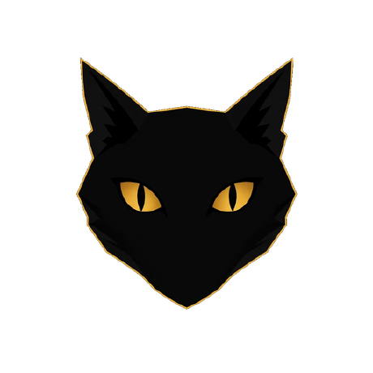

<!--
  Native GitHub profile README.
  Brand: ∅ — anonymous / abstract. No personal identity.
-->

  

   

  

  <h1>∅</h1>

  
<em>Silence. Signal net.</em>

  

    Une présence sans visage — 
    seulement le travail, et le regard.
  

  

 

## Fréquence

Pas de biographie. Pas de carte. Un flux de commits, des formes en C, parfois un signal plus large.

|  |  |
|:--|:--|
| **regard** | ce qui reste quand le visage n’est pas nommé |
| **signal** | code, diffs, silence entre les lignes |
| **∅** | ensemble vide — marque, pas identité |

 

  

 

## Traces

Travaux publics — à ouvrir sans présentation.

- [Libft-42](https://github.com/42randomuser/Libft-42) — fondations
- [ft_printf](https://github.com/42randomuser/ft_printf) — format
- [gnl](https://github.com/42randomuser/gnl) — lignes

 

  

  
∅ — le signal, pas le nom.

